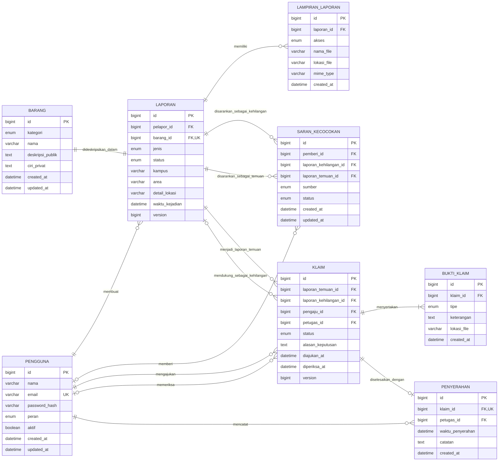

# ERD target Foundly

Dokumen ini adalah rancangan database target untuk fitur inti Foundly. Rancangan
difinalisasi pada 6 November 2026 sebagai acuan migrasi Flyway dan entity JPA
berikutnya. Implementasi database saat ini sudah berada pada V2: tabel `pengguna`,
`barang`, dan `laporan` beserta kepemilikan laporan sudah tersedia. Tabel target lain
di diagram belum berarti sudah dibuat di MySQL.

## Batas rancangan

- Lingkup produk tetap UPN “Veteran” Jakarta.
- Akun hanya memiliki dua peran: `PENGGUNA` dan `PETUGAS`. Petugas menangani fungsi
  administrasi versi awal; belum ada peran `ADMIN` terpisah.
- Laporan kehilangan tidak wajib dimiliki sebelum pengguna mengajukan klaim.
- Klaim selalu mengarah ke satu laporan penemuan dan boleh menghubungkan satu
  laporan kehilangan milik pengaju.
- Data barang pada laporan kehilangan dan penemuan tetap dua deskripsi terpisah.
  Kecocokan tidak menggabungkan kedua baris barang dan tidak otomatis membuktikan
  kepemilikan.
- Pengguna dapat membantu melalui `saran_kecocokan`. Saran menghubungkan satu laporan
  kehilangan dengan satu laporan penemuan, tetapi bukan klaim atau keputusan pemilik.
- Database menyimpan metadata lampiran. Lokasi penyimpanan file fisik ditentukan
  saat fitur unggah dibuat; file tidak disimpan sebagai BLOB di MySQL.
- GPS, peta, radius, chat, AI generatif, notifikasi eksternal, dan riwayat audit per perubahan
  status berada di luar ERD inti ini.

## Diagram

Diagram mempunyai relasi ganda dari `laporan` ke `saran_kecocokan` dan `klaim` karena
fungsi foreign key-nya berbeda. Pada saran, kedua laporan wajib diisi. Pada klaim,
`laporan_temuan_id` wajib dan `laporan_kehilangan_id` opsional. Jenis laporan yang
dirujuk diperiksa oleh domain/service karena foreign key biasa tidak dapat memastikan
nilai kolom `jenis` pada baris tujuan.

## Kamus data

### `pengguna`

| Kolom | Aturan | Keterangan |
| --- | --- | --- |
| `id` | PK, auto increment | Identitas akun |
| `nama` | wajib, maksimal 120 | Nama yang ditampilkan |
| `email` | wajib, maksimal 255, unique | Identitas login; dinormalisasi menjadi huruf kecil |
| `password_hash` | wajib, maksimal 255 | Hanya hash password, tidak pernah password asli |
| `peran` | wajib | `PENGGUNA` atau `PETUGAS` |
| `aktif` | wajib, default true | Menonaktifkan akun tanpa menghapus riwayat |
| `created_at`, `updated_at` | wajib | Waktu pembuatan dan perubahan akun |

Pendaftaran biasa selalu menghasilkan peran `PENGGUNA`. Pemberian peran `PETUGAS`
tidak boleh diterima dari request registrasi publik.

### `barang`

| Kolom | Aturan | Keterangan |
| --- | --- | --- |
| `id` | PK, auto increment | Identitas deskripsi barang |
| `kategori` | wajib | `ELEKTRONIK`, `KARTU_IDENTITAS`, atau `UMUM`; juga discriminator JPA |
| `nama` | wajib, maksimal 120 | Nama umum barang |
| `deskripsi_publik` | wajib, maksimal 2000 | Aman ditampilkan kepada semua pengguna |
| `ciri_privat` | wajib, maksimal 2000 | Hanya pelapor terkait dan petugas yang boleh melihat |
| `created_at`, `updated_at` | wajib | Waktu pembuatan dan perubahan |

Pewarisan Java tetap disimpan dengan strategi `SINGLE_TABLE`. Kategori menentukan
apakah JPA memuat `BarangElektronik`, `KartuIdentitas`, atau `BarangUmum`.

### `laporan`

| Kolom | Aturan | Keterangan |
| --- | --- | --- |
| `id` | PK, auto increment | Identitas laporan |
| `pelapor_id` | FK wajib ke `pengguna.id` | Akun pembuat laporan |
| `barang_id` | FK wajib dan unique ke `barang.id` | Satu deskripsi barang hanya dimiliki satu laporan |
| `jenis` | wajib | `KEHILANGAN` atau `PENEMUAN` |
| `status` | wajib | Mengikuti jenis dan alur status di bawah |
| `kampus` | wajib, maksimal 120 | Kampus UPNVJ |
| `area` | wajib, maksimal 120 | Gedung atau area |
| `detail_lokasi` | wajib, maksimal 500 | Keterangan titik perkiraan |
| `waktu_kejadian` | wajib | Waktu kehilangan atau penemuan, tidak boleh masa depan |
| `created_at`, `updated_at` | wajib | Waktu pembuatan dan perubahan laporan |
| `version` | wajib, default 0 | Optimistic locking agar perubahan bersamaan tidak saling menimpa |

Lokasi tetap berupa tiga field karena daftar area kampus belum ditetapkan dan GPS
bukan fitur inti. Nilai kampus/area nantinya diberikan melalui pilihan terkontrol di
aplikasi, sementara `detail_lokasi` tetap teks bebas.

### `lampiran_laporan`

| Kolom | Aturan | Keterangan |
| --- | --- | --- |
| `id` | PK, auto increment | Identitas metadata lampiran |
| `laporan_id` | FK wajib ke `laporan.id` | Laporan pemilik lampiran |
| `akses` | wajib | `PUBLIK` atau `PRIVAT` |
| `nama_file` | wajib, maksimal 255 | Nama file yang aman ditampilkan |
| `lokasi_file` | wajib, maksimal 500 | Key/path penyimpanan, bukan URL publik permanen |
| `mime_type` | wajib, maksimal 100 | Tipe file yang telah divalidasi |
| `created_at` | wajib | Waktu unggah |

Lampiran privat tidak boleh dikirim oleh endpoint daftar/detail publik.

### `saran_kecocokan`

| Kolom | Aturan | Keterangan |
| --- | --- | --- |
| `id` | PK, auto increment | Identitas saran |
| `pemberi_id` | FK opsional ke `pengguna.id` | Wajib untuk sumber `PENGGUNA`; kosong untuk saran sistem |
| `laporan_kehilangan_id` | FK wajib ke `laporan.id` | Harus merujuk laporan `KEHILANGAN` |
| `laporan_temuan_id` | FK wajib ke `laporan.id` | Harus merujuk laporan `PENEMUAN` |
| `sumber` | wajib | `PENGGUNA` atau `SISTEM` |
| `status` | wajib | `BARU`, `DILIHAT`, `DITOLAK`, atau `DILANJUTKAN` |
| `created_at`, `updated_at` | wajib | Waktu pembuatan dan perubahan saran |

Pasangan laporan kehilangan dan temuan harus unique agar saran yang sama tidak
berulang. Pengguna tidak dapat menyarankan dua laporan dengan jenis sama. Status
`DILANJUTKAN` hanya berarti penerima membuka alur klaim; saran tidak membuat klaim
otomatis dan tidak membuktikan kepemilikan. Pencocokan `SISTEM` nantinya memakai aturan
sederhana melalui interface strategi, bukan AI generatif.

### `klaim`

| Kolom | Aturan | Keterangan |
| --- | --- | --- |
| `id` | PK, auto increment | Identitas klaim |
| `laporan_temuan_id` | FK wajib ke `laporan.id` | Harus merujuk laporan `PENEMUAN` berstatus `TERSEDIA` |
| `laporan_kehilangan_id` | FK opsional ke `laporan.id` | Jika diisi, harus laporan `KEHILANGAN` milik pengaju |
| `pengaju_id` | FK wajib ke `pengguna.id` | Calon pemilik barang |
| `petugas_id` | FK opsional ke `pengguna.id` | Diisi saat pemeriksaan dimulai; harus berperan `PETUGAS` |
| `status` | wajib | Mengikuti alur klaim di bawah |
| `alasan_keputusan` | opsional, maksimal 2000 | Wajib ketika klaim ditolak atau dibatalkan petugas |
| `diajukan_at` | wajib | Waktu klaim dibuat |
| `diperiksa_at` | opsional | Waktu keputusan terakhir oleh petugas |
| `created_at`, `updated_at` | wajib | Waktu pembuatan dan perubahan data |
| `version` | wajib, default 0 | Optimistic locking untuk mencegah keputusan saling menimpa |

Pengaju tidak boleh merupakan pelapor laporan temuan yang sama. Maksimal satu klaim
aktif dari pengguna yang sama untuk laporan temuan yang sama. Maksimal satu klaim
berstatus `DISETUJUI` atau `SELESAI` untuk satu laporan temuan; service memproses
persetujuan dalam transaksi dan migrasi menyediakan unique constraint/index teknis.

### `bukti_klaim`

| Kolom | Aturan | Keterangan |
| --- | --- | --- |
| `id` | PK, auto increment | Identitas bukti |
| `klaim_id` | FK wajib ke `klaim.id` | Klaim pemilik bukti |
| `tipe` | wajib | `JAWABAN_CIRI`, `FOTO`, atau `DOKUMEN` |
| `keterangan` | wajib, maksimal 2000 | Jawaban atau penjelasan bukti |
| `lokasi_file` | opsional, maksimal 500 | Wajib untuk tipe `FOTO` atau `DOKUMEN` |
| `created_at` | wajib | Waktu bukti ditambahkan |

Setiap klaim wajib memiliki minimal satu bukti. Semua isi tabel ini privat bagi
pengaju klaim dan petugas; pelapor temuan tidak otomatis boleh melihatnya.

### `penyerahan`

| Kolom | Aturan | Keterangan |
| --- | --- | --- |
| `id` | PK, auto increment | Identitas penyerahan |
| `klaim_id` | FK wajib dan unique ke `klaim.id` | Satu klaim maksimal memiliki satu penyerahan |
| `petugas_id` | FK wajib ke `pengguna.id` | Petugas yang mencatat penyerahan |
| `waktu_penyerahan` | wajib | Waktu barang benar-benar diserahkan |
| `catatan` | opsional, maksimal 2000 | Catatan pemeriksaan akhir |
| `created_at` | wajib | Waktu record dibuat |

Penerima barang diperoleh dari `klaim.pengaju_id`, sehingga tidak diduplikasi di
`penyerahan`. Penyerahan hanya boleh dibuat dari klaim `DISETUJUI`.

## Alur status laporan

Status awal ditentukan oleh domain, bukan diterima dari request pembuatan laporan.

| Jenis | Dari | Ke | Pemicu |
| --- | --- | --- | --- |
| Kehilangan | dibuat | `AKTIF` | Pengguna membuat laporan |
| Kehilangan | `AKTIF` | `SELESAI` | Barang diserahkan melalui klaim terkait atau pelapor menandai sudah ditemukan |
| Kehilangan | `AKTIF` | `DIBATALKAN` | Pelapor membatalkan laporan |
| Penemuan | dibuat | `MENUNGGU_PENITIPAN` | Pengguna membuat laporan |
| Penemuan | `MENUNGGU_PENITIPAN` | `TERSEDIA` | Petugas menerima barang |
| Penemuan | `MENUNGGU_PENITIPAN` | `DIBATALKAN` | Penitipan tidak dilanjutkan atau laporan tidak valid |
| Penemuan | `TERSEDIA` | `MENUNGGU_PENYERAHAN` | Satu klaim disetujui |
| Penemuan | `MENUNGGU_PENYERAHAN` | `TERSEDIA` | Klaim yang disetujui dibatalkan sebelum penyerahan |
| Penemuan | `MENUNGGU_PENYERAHAN` | `SELESAI` | Penyerahan dicatat |
| Penemuan | `TERSEDIA` | `DIBATALKAN` | Petugas membatalkan laporan tidak valid/selesai di luar sistem dengan alasan |

`SELESAI` dan `DIBATALKAN` bersifat final. Perubahan status dilakukan melalui method
domain yang memvalidasi transisi, bukan setter umum.

## Alur status klaim

| Dari | Ke | Pemicu |
| --- | --- | --- |
| dibuat | `DIAJUKAN` | Pengguna mengirim klaim dengan bukti lengkap |
| `DIAJUKAN` | `DALAM_PEMERIKSAAN` | Petugas mengambil klaim untuk diperiksa |
| `DIAJUKAN` | `DIBATALKAN` | Pengaju menarik klaim |
| `DALAM_PEMERIKSAAN` | `DISETUJUI` | Petugas menyatakan bukti cukup |
| `DALAM_PEMERIKSAAN` | `DITOLAK` | Petugas menolak dengan alasan |
| `DALAM_PEMERIKSAAN` | `DIBATALKAN` | Pengaju menarik klaim sebelum keputusan |
| `DISETUJUI` | `SELESAI` | Penyerahan barang dicatat |
| `DISETUJUI` | `DIBATALKAN` | Petugas membatalkan sebelum penyerahan dengan alasan |

`DITOLAK`, `DIBATALKAN`, dan `SELESAI` bersifat final. Pembatalan klaim yang telah
disetujui mengembalikan laporan temuan ke `TERSEDIA`. Saat penyerahan dicatat dalam
satu transaksi: penyerahan dibuat, klaim menjadi `SELESAI`, laporan temuan menjadi
`SELESAI`, laporan kehilangan terkait (jika ada) menjadi `SELESAI`, dan klaim aktif
lain untuk temuan tersebut ditolak dengan alasan barang telah diserahkan.

## Aturan integritas dan penghapusan

1. Email pengguna unique dan selalu disimpan dalam bentuk ternormalisasi.
2. Foreign key inti menggunakan `RESTRICT`; data transaksi tidak ikut hilang karena
   akun atau laporan dihapus.
3. Akun dinonaktifkan melalui `aktif=false`. Laporan dan klaim ditutup melalui status;
   tidak ada hard delete setelah terlibat dalam klaim atau penyerahan.
4. Satu `barang` hanya boleh dimiliki satu `laporan`; `laporan.barang_id` unique.
5. Satu `klaim` maksimal memiliki satu `penyerahan`; `penyerahan.klaim_id` unique.
6. Constraint database membatasi nilai enum dan pasangan status/jenis laporan.
   Urutan transisi tetap divalidasi domain karena `CHECK` tidak menyimpan state lama.
7. Persetujuan klaim memakai transaksi, optimistic locking, dan unique index teknis
   agar dua petugas tidak dapat menyetujui dua klaim pada temuan yang sama.
8. Index pencarian disiapkan untuk `laporan(jenis,status,waktu_kejadian)`, lokasi,
   kategori barang, pasangan `saran_kecocokan`, `klaim(laporan_temuan_id,status)`,
   serta foreign key lain.
9. Pasangan laporan dalam `saran_kecocokan` unique; service memastikan satu laporan
   berjenis `KEHILANGAN` dan satunya `PENEMUAN`.
10. Waktu bisnis menggunakan zona Asia/Jakarta secara konsisten dengan implementasi
   saat ini. Format API harus menyatakan aturan ini secara eksplisit.

## Klasifikasi akses data

| Data | Publik | Pemilik data | Petugas |
| --- | --- | --- | --- |
| Nama/kategori/deskripsi publik barang | Ya | Ya | Ya |
| Lokasi dan waktu laporan | Ya, sesuai detail aman | Ya | Ya |
| Ciri privat barang | Tidak | Pelapor laporan tersebut | Ya |
| Lampiran publik | Ya | Ya | Ya |
| Lampiran privat | Tidak | Pelapor laporan tersebut | Ya |
| Saran kecocokan | Tidak pada halaman publik | Pemberi dan pemilik laporan terkait | Ya |
| Isi klaim dan bukti klaim | Tidak | Pengaju klaim | Ya |
| Alasan keputusan klaim | Tidak | Pengaju klaim | Ya |
| Password hash | Tidak | Tidak dikirim API | Tidak dikirim API |

DTO publik tidak boleh memuat field privat. Repository/entity tidak dikembalikan
langsung sebagai response JSON.

## Urutan implementasi database

Migrasi yang sudah diterapkan tidak diubah. V1 dan V2 telah dibuat; nomor dan isi
migrasi setelahnya bersifat rencana sampai file SQL-nya dibuat.

1. **V2 — pengguna dan kepemilikan laporan (selesai):** membuat `pengguna`, menambahkan
   `pelapor_id`, timestamp, dan version. Laporan V1 lama dipertahankan melalui akun
   migrasi nonaktif; autentikasi session cookie dan API akun dibuat pada tahap ini.
2. **V3 — penyempurnaan laporan:** memperluas constraint status dan membuat
   `lampiran_laporan` serta index pencarian.
3. **V4 — saran kecocokan:** membuat `saran_kecocokan`, aturan pasangan laporan,
   status saran, dan index pencegah duplikasi.
4. **V5 — klaim:** membuat `klaim`, `bukti_klaim`, constraint, dan index klaim aktif.
5. **V6 — penyerahan:** membuat `penyerahan` dan constraint penyelesaian.

Setiap migrasi langsung diikuti entity/repository/service/controller dan tes integrasi
fitur terkait. Docker tidak perlu dinyalakan untuk membaca atau meninjau rancangan ini.

## Keputusan yang masih berada di luar ERD

- Autentikasi sudah diputuskan dan diterapkan dengan Spring Security session cookie,
  BCrypt, CSRF, serta CORS ber-credential. Pengaturan HTTPS produksi masih menyusul.
- Penyedia penyimpanan file fisik ditentukan saat fitur lampiran dibuat.
- Daftar resmi kampus/area dan unit petugas penitipan perlu dikonfirmasi sebelum data
  pilihan lokasi diisi.
- ERD ini harus dicocokkan kembali jika rubrik/modul dosen mewajibkan struktur tertentu.
